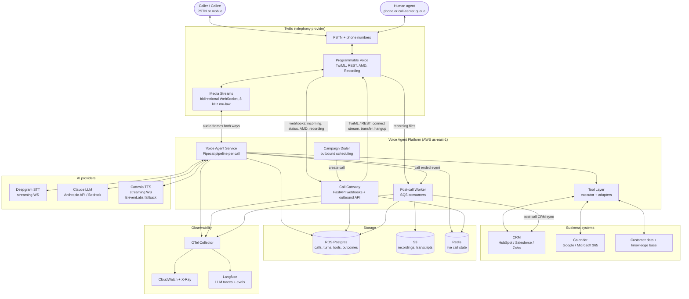
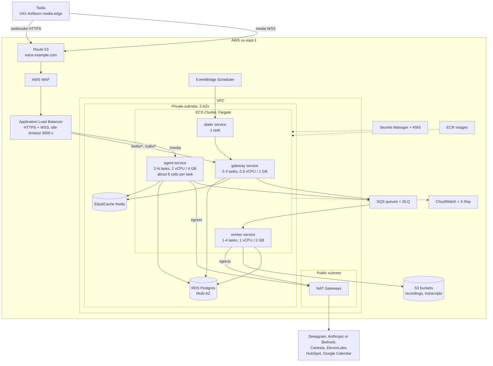

# Voice AI Agent Prototype: Architecture

| | |
|---|---|
| **Status** | Draft v0.1: design only, no implementation |
| **Date** | 2026-11-23 |
| **Companion docs** | [DATAFLOW.md](DATAFLOW.md) · [EVALUATION.md](EVALUATION.md) · [README.md](README.md) |

---

## 1. Goals and scope

The prototype is a voice agent that answers inbound calls and places outbound calls over the public phone network. It has to:

1. Hold natural, low-latency conversations for four playbooks: **lead qualification, support, appointment booking and follow-ups**.
2. Integrate with telephony: number routing, **transfer to a human**, **voicemail / answering-machine detection**, **call recording**.
3. Run a streaming **STT → LLM → TTS** pipeline with **barge-in** (caller interrupts the agent) and robust **turn-taking**.
4. Call **tools mid-conversation**: look up customer data, update a CRM, book a calendar slot.
5. Log every call: per-stage latency, transcripts, tool calls and outcomes, plus an **evaluation loop** to measure and improve quality.
6. Nice to have: multilingual, HubSpot/Salesforce/Zoho, Docker on AWS, call analytics.

**Prototype means**: one AWS region, a single tenant, up to 50 concurrent calls, production patterns (observability, failover, PII handling), but no multi-tenant billing, no admin UI beyond a read-only call viewer, and no HA database setup beyond RDS Multi-AZ.

---

## 2. Chosen stack (summary)

| Concern | Choice | Alternatives considered |
|---|---|---|
| Language | **Python 3.12** | TypeScript/Node |
| Real-time framework | **Pipecat** (open source, self-hosted) | LiveKit Agents, OpenAI Realtime, Vapi, Retell |
| Telephony | **Twilio** Programmable Voice + **Media Streams** (bidirectional WebSocket) | Plivo, Telnyx, raw SIP trunk |
| VAD / turn detection | **Silero VAD** + Pipecat **smart-turn** end-of-utterance model | Deepgram Flux built-in turn detection, LiveKit turn detector |
| STT | **Deepgram Nova-3** streaming (multilingual) | AssemblyAI Universal-Streaming, Google Chirp |
| LLM | **Claude Opus 5.5** (`claude-opus-5-5`) via the Anthropic API, with the same model on **Amazon Bedrock** as failover | Claude Haiku 5.5 (to benchmark for latency), GPT-class models via an adapter |
| TTS | **Cartesia Sonic** (primary), **ElevenLabs Flash** (fallback / cloned voices) | Deepgram Aura, Rime |
| Tools | In-process tool executor with typed JSON-schema tools; HubSpot + Google Calendar adapters first | MCP server per integration (later) |
| Data | **RDS PostgreSQL** (metadata), **S3** (recordings, transcripts), **ElastiCache Redis** (live call state) | DynamoDB |
| Async jobs | **SQS** + worker service | Celery, Step Functions |
| Observability | **OpenTelemetry** → CloudWatch / X-Ray, plus **Langfuse** for LLM traces | Datadog, Grafana Cloud |
| Deployment | **Docker** images on **ECS Fargate** behind an **ALB** in `us-east-1` | EKS, EC2 Auto Scaling |

Why each choice was made is in [§6 Key design decisions](#6-key-design-decisions-and-trade-offs).

---

## 3. System context

**Trust boundaries**: Twilio → Gateway (HTTP webhooks are validated with the `X-Twilio-Signature` HMAC); Twilio → Agent (the Media Stream WebSocket carries a short-lived signed token as a custom parameter, generated by the Gateway); Agent → providers (TLS, API keys from Secrets Manager); Agent → business systems (OAuth tokens per integration, least-privilege scopes).

---

## 4. Component breakdown

### 4.1 Call Gateway (`src/voice_agent/gateway`)

| | |
|---|---|
| **Responsibility** | Control plane for every call. It answers Twilio webhooks, decides routing (agent, human or voicemail), returns TwiML that opens a Media Stream to the Agent, exposes `POST /calls/outbound`, handles status, AMD and recording callbacks, and runs transfers through the Twilio REST API. |
| **Inputs** | Twilio webhooks (`/twilio/voice`, `/twilio/status`, `/twilio/amd`, `/twilio/recording`); outbound requests from the Dialer or the CRM; transfer requests from the Agent (internal HTTP). |
| **Outputs** | TwiML (`<Connect><Stream>`, `<Dial>`, `<Say>`, `<Hangup>`); Twilio REST calls (create call, update call, start recording); `Call` rows in Postgres; live state in Redis; `call.ended` messages to SQS. |
| **Tech** | FastAPI + Uvicorn, `twilio` Python SDK, Pydantic. Stateless, horizontally scaled. |

### 4.2 Voice Agent Service (`src/voice_agent/pipeline`, `turn`, `stt`, `llm`, `tts`)

| | |
|---|---|
| **Responsibility** | Owns the real-time media session for one call. It runs a Pipecat pipeline per call: Twilio serializer → VAD → STT → user-context aggregator → LLM (with tools) → sentence aggregator → TTS → Twilio serializer. It handles barge-in, turn-taking, silence re-prompts, filler phrases during tool calls, and records per-stage timings. |
| **Inputs** | Twilio Media Stream WebSocket (`/media`): `start`, `media` (base64 μ-law 8 kHz, 20 ms frames), `dtmf`, `mark`, `stop` events. Call context from Redis (contact, playbook, language, prompt version). |
| **Outputs** | Outbound `media` frames and `clear` events (barge-in flush) to Twilio; `Turn`, `TranscriptSegment` and `ToolInvocation` rows; OTel spans and metrics; transfer and hang-up requests to the Gateway. |
| **Tech** | Pipecat (`FastAPIWebsocketTransport` + `TwilioFrameSerializer`), Silero VAD (ONNX, in process), smart-turn v3 model (in process, CPU), Deepgram, Anthropic and Cartesia Pipecat services. |
| **State** | In memory per call (conversation context). Checkpointed to Redis after every turn so the Gateway can recover after a crash (see §6.6). |

### 4.3 Speech-to-Text (Deepgram)

| | |
|---|---|
| **Responsibility** | Streaming transcription with interim and final results, word timestamps and confidence, language detection (multilingual mode). |
| **Inputs** | 8 kHz μ-law audio, forwarded as is (Deepgram accepts `encoding=mulaw&sample_rate=8000`, so there is no resampling cost). |
| **Outputs** | Interim transcripts (used for early barge-in confirmation) and final transcripts (sent to the LLM). |
| **Config** | `model=nova-3`, `language=multi` or a fixed locale per number, `interim_results=true`, `smart_format=true`, `endpointing` disabled because our own VAD and smart-turn own end-of-turn, keyterm prompting for business names. |

### 4.4 LLM (Claude)

| | |
|---|---|
| **Responsibility** | Generates the agent's reply token by token; decides on tool calls; follows the playbook prompt. |
| **Inputs** | System prompt (playbook + business facts + style rules for speech), tool definitions, conversation history, final user transcript. |
| **Outputs** | Streamed text deltas; `tool_use` blocks. |
| **Model** | `claude-opus-5-5` with `output_config.effort = "low"` for conversational turns. Thinking is always on for this model, and `low` keeps it minimal. Because the latency budget is tight, **the first engineering task is to benchmark time-to-first-token for Opus 5.5 (low effort) against Claude Haiku 5.5** on recorded call transcripts. The switch rule is fixed in advance (§12, D10): if Opus 5.5 misses the TTFT target, live turns move to Haiku 5.5 and Opus 5.5 stays on post-call scoring. |
| **Latency levers** | Prompt caching on tools + system prompt (stable prefix, `cache_control`); streaming; `eager_input_streaming` on tools; short replies enforced by prompt; history trimming after N turns; optional fast mode on the Anthropic API. |
| **Tool calling** | `tool_choice: auto` (forced tool choice is not supported on this model), `strict: true` schemas, parallel tool calls allowed for independent lookups. |
| **Access** | Chosen with `LLM_PROVIDER`: the Claude API, or Amazon Bedrock through the `AsyncAnthropicBedrockMantle` client with model id `anthropic.claude-opus-5-5` (signed with the ECS task role, no stored keys). Both go through the same Pipecat service, so prompts, effort and caching are identical. The AWS demo runs on Bedrock (§12, D13); the other provider is the failover. Fast mode is not available on Bedrock. |

### 4.5 Text-to-Speech (Cartesia, ElevenLabs fallback)

| | |
|---|---|
| **Responsibility** | Converts streamed sentences to audio with the lowest possible time to first byte. |
| **Inputs** | Text chunks from the sentence aggregator (first chunk is flushed at the first clause boundary or 6+ words, so speech starts before the LLM finishes); voice id and language. |
| **Outputs** | Raw audio in `pcm_mulaw` at 8 kHz, which goes straight to Twilio with no transcoding. Word timestamps are used to know exactly what the caller heard before a barge-in. |
| **Tech** | Cartesia Sonic over WebSocket with a persistent `context_id` per turn, so in-flight generation can be cancelled. ElevenLabs Flash v2.5 over WebSocket is the fallback and the option for cloned brand voices. |

### 4.6 Tool Layer (`src/voice_agent/tools`)

| | |
|---|---|
| **Responsibility** | Typed, audited execution of side effects and lookups requested by the LLM. |
| **Tools (v1)** | `lookup_customer(phone)`, `get_order_status(order_id)`, `search_kb(query)`, `find_slots(service, date_range, tz)`, `book_slot(slot_id, contact, idempotency_key)`, `cancel_booking(booking_id)`, `crm_upsert_contact(...)`, `crm_log_call(...)`, `crm_update_deal_stage(...)`, `transfer_to_human(reason, queue)`, `end_call(disposition)`, `schedule_callback(datetime)` |
| **Guarantees** | Per-tool timeout (default 2.5 s) and one retry for idempotent reads. **Idempotency keys** on every write (`call_id + tool + hash(args)`), so a retried or duplicated LLM call cannot double-book. Argument validation against the schema before execution. Allow-list per playbook (for example, support cannot `update_deal_stage`). Write tools require a confirmation read-back to the caller ("Tuesday at 3 pm, correct?"), which the prompt enforces and the tool checks through a `confirmed=true` argument. |
| **Adapters** | `CalendarProvider` (Google first), `CRMProvider` (HubSpot first; Salesforce and Zoho implement the same interface), `DataProvider`. |
| **Outputs** | `ToolInvocation` rows (args redacted, result summary, latency, status). |

### 4.7 Post-call Worker (`src/voice_agent/worker`)

Consumes `call.ended` and `recording.completed` from SQS. It downloads the Twilio recording to S3 and then deletes it from Twilio, builds the final transcript JSON, runs PII redaction, runs LLM-judge scoring (see EVALUATION.md), syncs the call summary and disposition to the CRM, and emits analytics events. It is idempotent and retried with a dead-letter queue.

### 4.8 Campaign Dialer (`src/voice_agent/campaigns`)

Schedules outbound calls (follow-ups, reminders, lead callbacks). It enforces calling hours in the callee's local time zone, DNC lists, consent flags, per-campaign concurrency caps and retry rules (for example, voicemail → retry in 4 h, max 3 attempts). It is triggered by EventBridge Scheduler or a CRM webhook and creates calls through the Gateway.

### 4.9 Storage

| Store | What | Why |
|---|---|---|
| RDS PostgreSQL 16 (Multi-AZ) | Calls, turns, transcript segments, tool invocations, outcomes, contacts, campaigns, eval results | Relational queries for analytics; JSONB for flexible payloads |
| S3 (SSE-KMS, versioned, lifecycle rules) | Dual-channel recordings (WAV/MP3), raw and redacted transcript JSON, eval artifacts | Cheap, durable, lifecycle-based retention |
| ElastiCache Redis | Live call state (`call:{sid}`), transfer coordination, idempotency keys (TTL 24 h), conversation checkpoints | Sub-millisecond reads, TTLs |
| Secrets Manager | Provider API keys, OAuth refresh tokens | Rotation, IAM-scoped access |

### 4.10 Observability (`src/voice_agent/observability`)

OpenTelemetry SDK in every service, with an OTel Collector sidecar per ECS task. Traces go to X-Ray, metrics and logs to CloudWatch, and LLM generations and tool spans to Langfuse (prompt versions, token usage, eval scores). One trace per call (`trace_id` derived from the Twilio `CallSid`), with child spans per turn and per stage. Details are in [EVALUATION.md](EVALUATION.md).

---

## 5. Deployment view

### Containers

| Image | Process | Scales on | Notes |
|---|---|---|---|
| `voice-gateway` | Uvicorn (FastAPI) | Request count / CPU | Stateless; Twilio expects a webhook reply within about 15 s, and we target under 300 ms |
| `voice-agent` | Uvicorn (FastAPI WebSocket) + Pipecat | **Custom metric `ActiveCalls / task`** (target 6 of 8 capacity) | CPU-bound on VAD and smart-turn. Capacity per task must be load-tested. Scale-in protection while calls are active; ALB deregistration delay of 1800 s (= max call length) so calls drain instead of dropping |
| `voice-worker` | SQS consumer | SQS queue depth | Recording downloads, scoring, CRM sync |
| `voice-dialer` | Scheduler loop | Fixed (1) | Leader-elected through a Redis lock if scaled |
| `otel-collector` | Sidecar in each task | n/a | Batches spans and metrics |

**Why `us-east-1`**: Twilio's default media region (US1) is in Ashburn, and Deepgram, Cartesia and Anthropic serve low-latency US endpoints. Keeping agent ↔ Twilio and agent ↔ providers in one region removes 20–60 ms per hop. For non-US callers, the plan is to add regions with Twilio Regional (IE1, AU1) plus a regional agent deployment.

**Local development**: `docker compose` runs gateway, agent, worker, Postgres, Redis and LocalStack (S3, SQS). An ngrok tunnel exposes the gateway and agent to Twilio. See [README.md](README.md).

---

## 6. Key design decisions and trade-offs

### 6.1 Framework: Pipecat (chosen) vs. LiveKit Agents vs. hosted platforms

| Option | Pros | Cons | Verdict |
|---|---|---|---|
| **Pipecat** | Native Twilio Media Streams serializer (μ-law, `clear` for barge-in, `mark` for playback tracking); runs inside our own FastAPI container, so **no extra media server to operate**; explicit frame pipeline that is easy to instrument per stage and to swap providers in; built-in interruption strategies and smart-turn; BSD license; Python | We own scaling and ops; WebSocket media (TCP) is slightly less loss-tolerant than WebRTC/RTP | **Chosen.** Best fit for "Twilio + Docker on AWS + full observability" |
| LiveKit Agents | Excellent turn-detector model; WebRTC transport; built-in worker dispatch and load balancing; good for web and mobile clients and multi-party calls | Requires a LiveKit server plus a SIP service (LiveKit Cloud or self-hosted), with Twilio as an Elastic SIP trunk: more moving parts for a phone-only prototype | **Migration path** if the client adds browser or app voice, or needs conference-style warm transfers |
| OpenAI Realtime / other speech-to-speech | Potentially lowest latency; natural prosody | Less control over STT/TTS voices and languages; weaker per-stage observability; harder to audit transcripts; single-vendor lock-in | Not chosen. Can be added later as an alternative pipeline behind the same transport |
| Vapi / Retell | Days to a demo; telephony built in | Black box; per-minute platform markup; limited control of barge-in, logging and data residency | Not chosen. **Useful as a latency and quality benchmark baseline** |

**Python over TypeScript**: Pipecat and LiveKit Agents are Python-first (the TS SDKs lag behind on features), VAD and turn models run in Python ONNX runtimes, and the evaluation and analytics stack (pandas, LLM-judge harnesses) is Python. TypeScript would only win if the client's team is Node-only.

**Twilio over Plivo/Telnyx**: most mature Media Streams, AMD, Recording and transfer APIs, plus the largest ecosystem. Telnyx is cheaper per minute and owns its network (potentially lower latency). The `telephony` module hides the provider behind an interface, so switching later is contained.

### 6.2 Streaming vs. batch

All three AI stages **stream** and overlap:

* STT streams interim results while the caller speaks, so the final transcript arrives about 60 ms after end-of-turn instead of after uploading a full clip (batch STT would add 300–1000 ms).
* The LLM streams tokens. A **sentence aggregator** sends the first clause to TTS as soon as it is complete (minimum about 6 words or punctuation), so TTS starts before the LLM finishes.
* TTS streams audio. The first 20 ms frame goes to Twilio as soon as it arrives.

Batch is used only **after** the call: high-accuracy re-transcription (optional, Deepgram pre-recorded with diarization over the dual-channel recording), summarization, scoring and CRM sync.

### 6.3 Turn-taking and barge-in

* **End-of-turn** = Silero VAD silence ≥ 200 ms **and** smart-turn model probability ≥ 0.5 that the utterance is complete. If smart-turn says "incomplete" (for example, "my number is 555…"), wait up to 1.5 s more before taking the turn. This avoids interrupting callers who pause mid-sentence without making every turn slow.
* **Barge-in** (caller speaks while the agent is talking):
  1. VAD detects speech start (≥ 120 ms of speech, to ignore coughs and line noise).
  2. Interruption strategy: confirm with at least 1 interim STT word (configurable; for noisy lines, require 2 words).
  3. Pipecat emits an `InterruptionFrame`. The LLM stream is cancelled, the TTS context is cancelled, and the outbound queue is flushed.
  4. A Twilio **`clear`** message is sent so Twilio drops its buffered audio immediately.
  5. The agent's last assistant message is **truncated to what was actually played** (tracked with Twilio `mark` events plus TTS word timestamps), so the LLM's history matches what the caller heard.
* **Backchannels** ("uh-huh", "yeah") during agent speech are ignored by the 1–2 word rule plus a short stop-word list.
* **Silence**: re-prompt after 6 s ("Are you still there?"), and end politely after 2 re-prompts.
* **Non-interruptible segments**: legally required disclosures (recording notice, AI disclosure) are marked uninterruptible.

### 6.4 Tool calls without dead air

When the LLM emits a tool call, the agent says a short **filler** first. This is either the LLM's own preamble text, which streams to TTS before the `tool_use` block, or a canned phrase if the tool is expected to take more than 700 ms ("Let me check the calendar for you…"). Independent tool calls run in parallel. If a tool exceeds its timeout, the LLM receives an `is_error` result and says so in plain words ("I'm having trouble reaching the calendar; can I text you a booking link?").

### 6.5 Transfers to humans

* **Cold transfer** (default for the prototype): the Gateway updates the live call with TwiML `<Dial>` to the target number or SIP queue. The Media Stream closes and the agent session ends with disposition `transferred`.
* **Warm transfer** (phase 2): the call moves into a Twilio `<Conference>`. The agent dials the human as a second participant, speaks a whisper summary to them only (`coach` mode, or a pre-announce TwiML), then drops out. This needs a conference-capable flow and is deferred to phase 2 (§12, D3).
* The agent **always** gives the caller a reason and a fallback ("If nobody picks up, I'll have someone call you back within the hour").

### 6.6 Failover and resilience

| Failure | Detection | Response |
|---|---|---|
| Agent service unreachable when a call arrives | Gateway health check / Twilio fallback URL | Twilio `fallbackUrl` returns TwiML: brief apology, then `<Dial>` to a human line or `<Record>` voicemail |
| Agent task crashes mid-call | Media stream `stop` without a `call.ended` event; Twilio status callback still `in-progress` | Gateway redirects the call: restore the context checkpoint from Redis and reconnect to a new agent task ("Sorry, I lost you for a second…"), or transfer to a human |
| STT provider error or timeout | No transcript for more than 2 s while VAD reports speech | Switch the session to the secondary STT (Deepgram secondary region, or AssemblyAI) |
| LLM error, 429 or TTFT over 1.5 s | Circuit breaker on the error rate and on p95 TTFT | Retry once on Bedrock (same model); if that also fails, say a canned "one moment" and transfer |
| TTS error | Missing first byte within 800 ms | Switch to ElevenLabs for the rest of the call (a different voice is acceptable) |
| Tool or CRM outage | Tool timeout or error | Graceful verbal fallback; queue the write in SQS for retry; never claim success without confirmation |
| Database outage | Repository errors | The call continues (in-memory state); events buffer to SQS or local disk and are persisted later |

### 6.7 Audio format: stay μ-law end to end

Twilio sends 8 kHz μ-law. Deepgram accepts it directly, and Cartesia and ElevenLabs can **output** 8 kHz μ-law. Avoiding resampling and transcoding saves CPU and 5–15 ms per hop. VAD needs 16 kHz PCM, so we upsample **only** on the VAD branch, in process.

### 6.8 Prompt and agent versioning

Every call stores `agent_version` (prompt hash, tool set version, model id, voice id, and turn-taking config). This is what makes the evaluation loop work, because quality changes can be tied to versions and A/B tested by routing a percentage of calls per number.

---

## 7. Latency budget

**Definition**: *voice-to-voice latency* = time from when the caller **stops speaking** to when the **first audio of the agent's reply reaches the caller's Twilio media edge**. The carrier/PSTN leg (caller handset ↔ Twilio edge, typically 50–150 ms each way, outside our control) is measured separately and **excluded** from the budget.

| # | Stage | Target p50 | Ceiling p95 | How we hit it |
|---|---|---|---|---|
| 1 | Inbound audio transport: Twilio edge → Agent (WSS, same region) | 30 ms | 60 ms | Agent in `us-east-1` next to Twilio US1 |
| 2 | Frame buffering (20 ms μ-law frames) | 20 ms | 40 ms | No extra jitter buffer; process frame by frame |
| 3 | End-of-turn detection (VAD silence + smart-turn) | 200 ms | 300 ms | 200 ms VAD stop window; smart-turn inference about 10–20 ms on CPU |
| 4 | STT final transcript after end-of-turn | 60 ms | 150 ms | Streaming with interims; `Finalize` message on VAD stop |
| 5 | **LLM time-to-first-token** | 280 ms | 500 ms | Prompt caching, low effort, short context, warm HTTP/2 connection. **Must be confirmed by the week-1 benchmark** |
| 6 | Sentence aggregation (first speakable chunk) | 30 ms | 80 ms | Flush at the first clause boundary or 6 words |
| 7 | **TTS time-to-first-byte** | 90 ms | 180 ms | Cartesia WebSocket kept open per call, μ-law output |
| 8 | Outbound audio transport: Agent → Twilio edge → playback start | 50 ms | 90 ms | Same region; send frames immediately |
| | **Total voice-to-voice** | **760 ms** | **~1,400 ms** | **Target: p50 ≤ 800 ms**, p95 ≤ 1,500 ms |

**Related budgets** (used in the [DATAFLOW.md](DATAFLOW.md) sequence diagrams):

| Interaction | Target |
|---|---|
| Barge-in: caller starts speaking → agent audio stops at Twilio | ≤ 250 ms (VAD 120 ms + 1 interim word ~80 ms + `clear` ~50 ms) |
| Tool turn: end-of-turn → filler audio starts | ≤ 800 ms (same path as a normal turn) |
| Tool execution (lookups / calendar booking) | p50 400 ms / p95 1,500 ms, hard timeout 2.5 s |
| Tool turn: end-of-turn → answer audio starts | ≤ 2,200 ms p95 (filler covers the gap) |
| Inbound call answered → greeting audio starts | ≤ 1,200 ms (pre-warmed STT/TTS connections; greeting is pre-synthesized and cached per agent version) |
| Webhook response time (Gateway) | ≤ 300 ms p95 |

Every stage above is a separate metric (see EVALUATION.md §2), so a regression shows up in the stage that caused it.

---

## 8. Security, privacy and compliance (added to the brief)

These items were not in the brief but are needed for any production-style phone agent:

* **Recording consent**: play a recording disclosure at the start of every call. Some US states (for example, CA, FL, WA, PA) require two-party consent. Make the disclosure uninterruptible and log it as a `Turn` with `kind = disclosure`.
* **AI disclosure**: several jurisdictions and the FCC's 2024 ruling treat AI-generated voices in outbound calls as "artificial voice" under the TCPA. Outbound calls need **prior express consent** and an AI disclosure. The dialer checks a consent flag per contact.
* **Outbound compliance**: calling-hour windows (8 am–9 pm callee local time), internal DNC plus the National DNC registry scrub, frequency caps, opt-out handling ("stop calling me" triggers the `end_call` tool with disposition `opt_out` and a DNC write).
* **Caller ID reputation**: register numbers for STIR/SHAKEN attestation (Twilio Trust Hub) and CNAM, otherwise outbound calls get labelled "Spam Likely".
* **PII**: redaction of transcripts and logs, KMS encryption, retention limits (see DATAFLOW.md §5). **No card numbers by voice** in the prototype. If payments are needed, use Twilio `<Pay>` (PCI-scoped) instead of the LLM path.
* **Prompt injection from callers**: callers can say anything. Tools are allow-listed per playbook, write tools need confirmation, tool arguments are validated server-side (the LLM cannot pick another customer's record; `lookup_customer` is bound to the caller's verified phone number unless identity is verified another way), and the system prompt is never spoken back.
* **Webhook security**: Twilio signature validation on every webhook; WebSocket token check; WAF rate limits.
* **Secrets**: Secrets Manager only, never in images or env files committed to git.
* **HIPAA / GDPR**: not assumed for the prototype (see assumptions). If needed, this requires BAAs with every vendor (Twilio, Deepgram, Cartesia/ElevenLabs, the LLM provider, AWS) and changes to retention.

---

## 9. Other scope additions (not in the brief, recommended)

| Addition | Why |
|---|---|
| **DTMF handling** | Callers may press keys ("press 0 for a human"); Pipecat surfaces DTMF frames. The agent supports `0` → transfer and digit entry for account numbers |
| **Max call duration and cost guard** | Hard stop at 30 min; alert if cost per call is above a threshold |
| **Pre-synthesized prompts** | Greeting, disclosures and fillers are cached as audio per voice and version: 0 ms TTS latency and lower cost |
| **Knowledge base (RAG) for support** | The `search_kb` tool over a pgvector index of FAQs/docs, so support answers are grounded |
| **Simulated-caller test harness** | An LLM-driven caller that phones the agent, used for regression tests before every prompt change (see EVALUATION.md) |
| **Human review queue** | Low-scoring calls are sampled for human QA review; labels feed back into prompt fixes |
| **Per-minute cost model** | Telephony + STT + LLM tokens + TTS, tracked per call so the client sees unit economics |
| **Time-zone correctness** | Every booking is stored in UTC with the caller's IANA time zone; the agent always speaks the slot in the caller's local time |
| **CI/CD** | GitHub Actions: lint, unit tests, simulated-call regression suite, then build, push to ECR and deploy to ECS (blue/green) |
| **Feature flags / traffic split** | Route X% of calls to a new `agent_version` for A/B evaluation |

---

## 10. Ambiguities in the spec

1. **Which playbook first?** Qualification, support, booking and follow-ups have different success criteria. The prototype needs one primary playbook to tune against.
2. **Volume and concurrency**: no numbers given for calls per day, peak concurrent calls, or the inbound/outbound mix.
3. **"Production-style prototype"**: unclear whether this means "demo-quality with production patterns" or "pilot with real customers". This affects HA, compliance and review needs.
4. **Transfer target**: a PSTN number, a call-center platform (Twilio Flex, Five9, Genesys), or a SIP PBX? Cold or warm transfer?
5. **Voicemail behaviour**: on outbound calls answered by a machine, should the agent leave a message, hang up, or retry later? Should inbound calls offer voicemail when no human is available?
6. **Calendar provider**: Google, Microsoft 365, Calendly or Cal.com? One shared calendar or per-staff calendars with routing rules?
7. **CRM**: "HubSpot/Salesforce/Zoho" — which one is real for this client, and which objects (contacts, leads, deals, tickets) must be written?
8. **Languages**: "multilingual" does not say which languages, or whether a call can switch languages mid-call.
9. **Recording**: always on? Dual-channel? Who may access recordings, and for how long?
10. **Regulated data**: no mention of HIPAA (healthcare booking?), PCI (payments?) or GDPR (EU callers?).
11. **Phone numbers**: port existing numbers to Twilio, forward existing numbers, or buy new ones?
12. **Brand voice**: stock voice or a cloned brand voice (needs consent and a contract)?
13. **LLM choice**: "any capable model" leaves the cost vs. latency vs. quality trade-off open.
14. **Analytics consumer**: who reads call analytics (ops team dashboard, BI tool, CRM reports)?

## 11. Assumptions made

No client input is available for this prototype, so every open point is settled by an assumption. The concrete prototype decisions are in §12; this table is the short version.

| # | Assumption |
|---|---|
| A1 | The pilot business is a fictional **multi-location home-services company** (HVAC and plumbing). The first playbook is **appointment booking with lead qualification**. Support and follow-ups reuse the same pipeline with different prompts and tools. |
| A2 | Up to **50 concurrent calls**, about 2,000 calls per day, roughly 60% inbound. |
| A3 | **US phone numbers**, US callers, **English and Spanish**, including switching language mid-call. |
| A4 | **Cold transfer** to one dispatch number; warm transfer is phase 2. |
| A5 | Outbound calls go only to contacts with a recorded consent flag (existing customers and people who asked for a callback). **No cold outreach.** |
| A6 | **Google Calendar** and **HubSpot** are the only adapters built; Salesforce and Zoho are interface stubs. |
| A7 | **Dual-channel recording is on** for every call, with a disclosure. |
| A8 | **No HIPAA, PCI or GDPR scope**. The agent refuses card numbers and health details. |
| A9 | Single region `us-east-1`, single tenant, in a **new AWS account we set up ourselves**. |
| A10 | New Twilio numbers are bought for the pilot (no porting). |
| A11 | Stock voices from Cartesia; no voice cloning. |
| A12 | LLM for live turns is Claude Opus 5.5 at low effort, with a measured switch rule to Claude Haiku 5.5 (§12, D10). |

## 12. Prototype decisions (in place of client answers)

These were open questions for a client. Because there is no client to ask, each one has a fixed answer so that building can start. The last column says when a decision should be revisited if this becomes a real engagement.

| # | Question | Decision for the prototype | Revisit when |
|---|---|---|---|
| D1 | Which use case is the pilot, and what counts as success? | **Inbound booking + qualification** for the home-services company. A call succeeds when (a) a Google Calendar event is created **and** (b) a HubSpot contact exists with all required fields: name, phone, ZIP code, service type, urgency. Follow-up calls (reminders, reschedules) are the second playbook; support is third. | A real client names a different first use case |
| D2 | Call volume, concurrency, business hours? | 2,000 calls per day, **50 peak concurrent**, load-tested to **100**. The agent answers **24/7**; human transfer is offered only 8 am–8 pm ET, Monday to Saturday. Outside those hours a transfer request becomes a callback task. | Real traffic data exists |
| D3 | Where do transfers go? Warm transfer? | **Cold transfer** to one Twilio number standing in for the dispatch line (`TRANSFER_DEFAULT_NUMBER`). The CRM note with the AI summary is written before the transfer, so the human can see context. Warm transfer (conference + whisper summary) is phase 2. | The client has a call-center platform (Flex, Five9, Genesys) or a PBX |
| D4 | Which CRM and calendar, and which fields? | **HubSpot** (free developer test portal) and **Google Calendar** (one shared calendar, 1-hour slots, 8 am–6 pm local). HubSpot objects written: **contact** (name, phone, email if given, ZIP, preferred language), **deal** in an "AI Inbound Calls" pipeline (service type, urgency, lead score, stage), **meeting** linked to the contact, and a **call note** with the summary and disposition. | The client uses Salesforce or Zoho, or needs per-technician calendars |
| D5 | Languages; mid-call switching? | **English and Spanish.** Deepgram `language=multi` detects the language per utterance. If two consecutive caller turns are in the other language, the agent switches its reply language and the Cartesia voice. Other languages get a polite English/Spanish message and a callback offer. | Demand for other languages |
| D6 | Outbound voicemail policy and consent? | Outbound calls only go to contacts with `consent_outbound_ai = true` (set when a caller asks for a callback or books an appointment). **If voicemail is detected, leave a short (about 20-second) message** with the callback number, then retry up to 3 times, at least 4 hours apart, inside calling hours. | Any cold-outreach campaign is planned (it needs a legal review first) |
| D7 | Regulated data? | **None in scope.** The prompt tells the agent to decline card numbers, SSNs and medical details and to offer a human callback instead. No BAAs or DPAs are needed for the prototype. | Healthcare, payments or EU callers come into scope |
| D8 | Recording retention and access? | Recordings **90 days**, raw transcripts **30 days**, redacted transcripts **1 year**, metadata **2 years** (as in DATAFLOW.md §5). Access is limited to two IAM roles: `ops-admin` and `qa-reviewer`. | Client legal or compliance input |
| D9 | Cloned voice or stock voice? | **Stock Cartesia voices**: one English, one Spanish, both chosen for clarity on 8 kHz phone audio. | The client wants a brand voice (needs consent and a contract with the voice owner) |
| D10 | Larger or smaller LLM? | Start with **Claude Opus 5.5 at low effort** for live turns. In week 1, benchmark it against **Claude Haiku 5.5** on 200 recorded turns. **If Opus 5.5's p50 TTFT is above 400 ms, or its p95 is above 700 ms, live turns move to Haiku 5.5**, and Opus 5.5 stays as the post-call judge (`JUDGE_MODEL`). If Haiku 5.5 is chosen, the simulated-call suite must still pass at the same task-success bar. | Benchmark results, or a much larger change in model pricing or speed |
| D11 | Port numbers or buy new ones? | **Buy two new US local numbers**: one inbound and one outbound caller ID. The outbound number is registered in Twilio Trust Hub (STIR/SHAKEN, CNAM). | A real business with existing numbers |
| D12 | AWS account and security conventions? | A **new AWS account** with our own Terraform conventions: one VPC, private subnets for all services, Secrets Manager for every secret, CloudTrail on, no public database endpoints. A lightweight security self-review (OWASP and LLM-specific checks) happens before any real caller is connected. | A client with existing AWS standards |
| D13 | Which LLM provider for the AWS demo? | **Amazon Bedrock as primary**, so the demo runs in one AWS account with IAM roles and AWS billing and no Anthropic key. Same model and settings as the Claude API, which stays one setting away (`LLM_PROVIDER=anthropic`). Bedrock latency is checked with `voice-llm-check` and the per-turn LLM TTFT metrics against the D10 thresholds. | Bedrock TTFT clearly worse than the Claude API, or a need for features Bedrock lacks (fast mode, server-side refusal fallbacks) |
