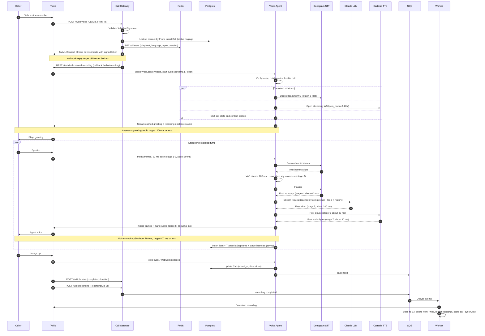
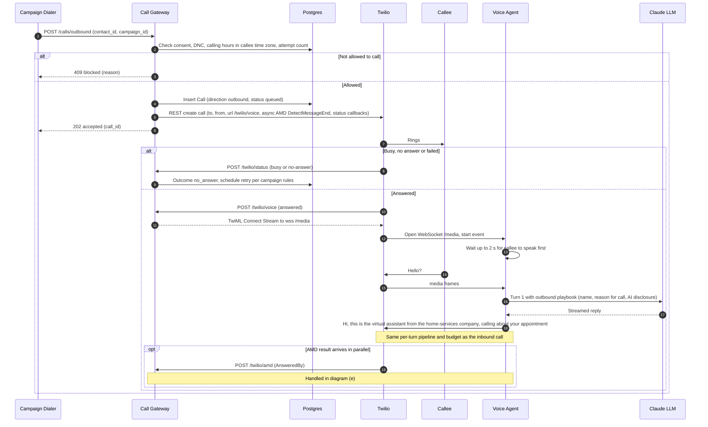
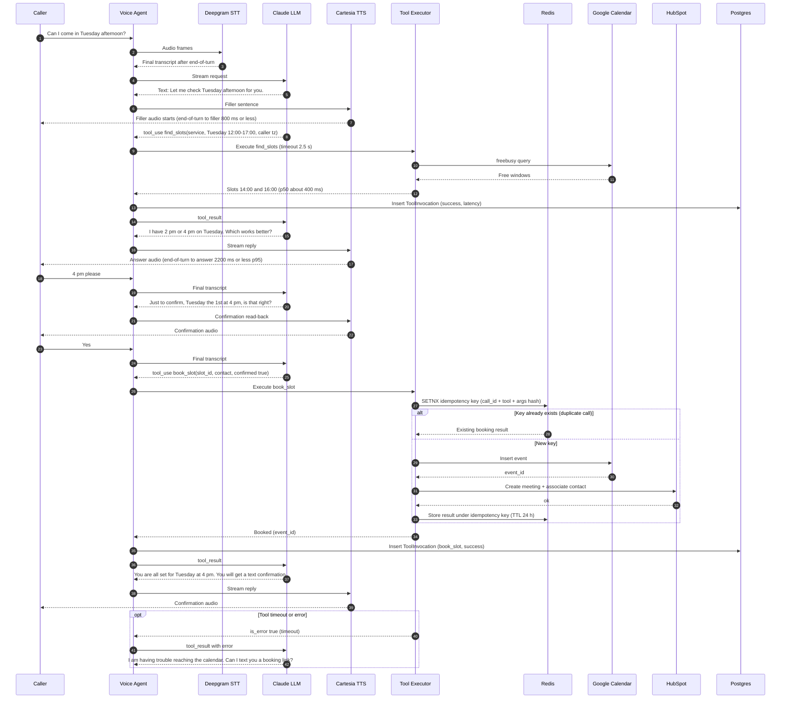
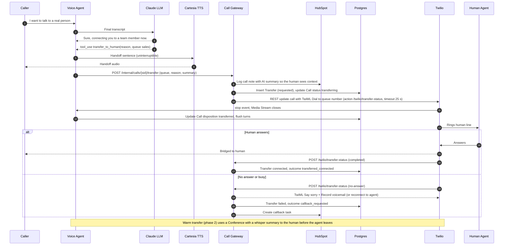
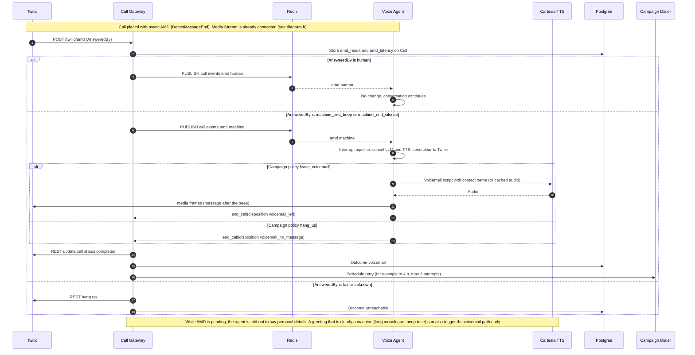
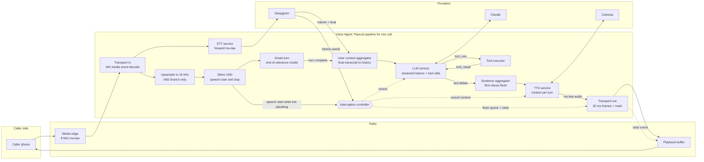
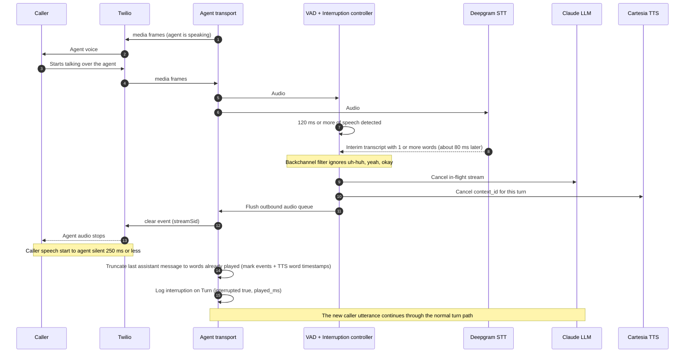
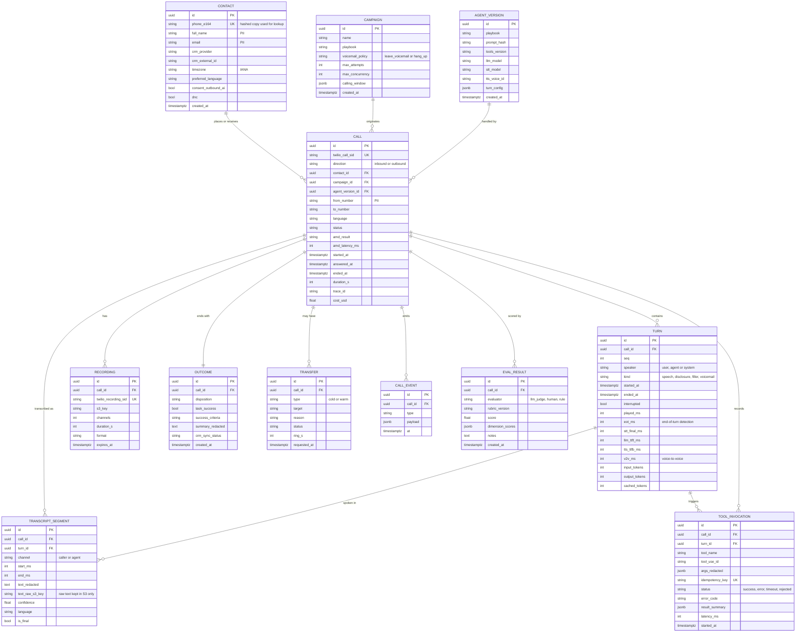
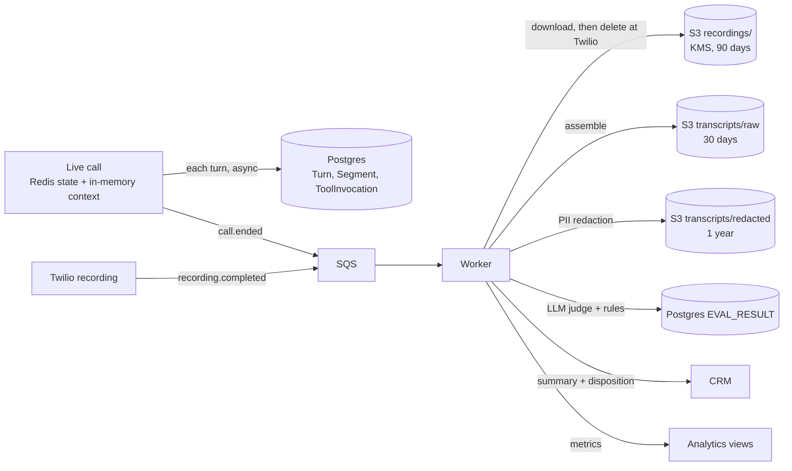

# Voice AI Agent Prototype: Dataflow

Companion to [ARCHITECTURE.md](ARCHITECTURE.md). The timings in the sequence diagrams match the latency budget in ARCHITECTURE.md §7: p50 values for stages 1–8, which add up to a **760 ms voice-to-voice** p50.

**Participants used throughout**

| Short name | Component |
|---|---|
| Caller | Person on the phone (inbound caller or outbound callee) |
| Twilio | Twilio Programmable Voice + Media Streams |
| GW | Call Gateway (FastAPI webhooks, Twilio REST) |
| Agent | Voice Agent Service (Pipecat pipeline for this call) |
| VAD | Silero VAD + smart-turn (in process, inside Agent) |
| STT | Deepgram streaming |
| LLM | Claude (`claude-opus-5-5`) via the Anthropic API or Bedrock |
| TTS | Cartesia streaming (ElevenLabs fallback) |
| Tools | Tool executor + adapters (Calendar, CRM, data) |
| Redis / PG / SQS / S3 | Live state / Postgres / queue / object storage |
| Worker | Post-call worker |

---

## 1. Sequence diagrams

### (a) Inbound call

### (b) Outbound call

### (c) Mid-call tool call: booking a calendar slot

### (d) Transfer to a human (cold transfer)

### (e) Voicemail / answering-machine detection (outbound)

**Inbound voicemail** (no agent, or after hours): the Gateway returns TwiML `Say` + `Record` with a transcription callback. The Worker stores the audio in S3 and creates a `Call` with `disposition = voicemail_received` plus a CRM task.

---

## 2. Audio path

### 2.1 End-to-end frame path

**Step by step (normal turn)**

1. **Caller audio → Twilio media stream**: Twilio sends JSON `media` events, each carrying 20 ms of base64 8 kHz μ-law audio (160 bytes).
2. **Transport in**: Pipecat's `TwilioFrameSerializer` decodes them into `InputAudioRawFrame`s.
3. **STT streaming**: μ-law frames go straight to Deepgram (no resampling). Interim transcripts come back continuously.
4. **VAD**: a copy of each frame is upsampled to 16 kHz PCM for Silero. The VAD emits `UserStartedSpeaking` / `UserStoppedSpeaking` (200 ms stop window).
5. **Turn detection**: on stop, the smart-turn model scores the last utterance. If complete, the turn ends: the agent sends Deepgram `Finalize` and the final transcript is appended to the LLM context. If incomplete, it waits up to 1.5 s more.
6. **LLM**: a streaming request with a cached prefix (tools + system prompt) and the rolling history. Text deltas flow out immediately.
7. **Tool calls**: any preamble text is spoken first (filler). `tool_use` blocks go to the tool executor; results return as `tool_result` and the LLM continues (diagram c).
8. **Sentence aggregation**: the first clause (punctuation or ≥ 6 words) goes to TTS immediately; later text goes sentence by sentence.
9. **TTS streaming**: Cartesia returns `pcm_mulaw` 8 kHz chunks plus word timestamps.
10. **Transport out**: chunks are re-framed to 20 ms `media` events. A `mark` event is sent after each sentence so we know when Twilio has played it.
11. **Caller hears the agent.**

### 2.2 Barge-in cancellation

Segments flagged `uninterruptible` (legal disclosures, transfer hand-off sentence) skip steps 9–12: caller speech is buffered and handled after the segment ends.

---

## 3. Data model

**Disposition values (`OUTCOME.disposition`)**: `booked`, `qualified`, `not_qualified`, `resolved`, `unresolved`, `transferred_connected`, `transfer_failed`, `callback_requested`, `voicemail_left`, `voicemail_no_message`, `voicemail_received`, `no_answer`, `busy`, `opt_out`, `caller_hung_up`, `error`.

**Relationships in words**: a `Call` belongs to at most one `Contact` (unknown callers create a stub contact), one `Campaign` (outbound only) and exactly one `AgentVersion`. A call has many `Turn`s in order (`seq`). Each turn has 1..n `TranscriptSegment`s and 0..n `ToolInvocation`s. A call has 0..n `Recording`s (usually one dual-channel recording), exactly one `Outcome`, 0..n `Transfer`s, an append-only `CallEvent` log (webhooks, AMD, interruptions, failovers) and 0..n `EvalResult`s.

---

## 4. What happens to data after a call

---

## 5. Data storage, retention and PII handling

### 5.1 What is stored where

| Data | Store | Contains PII? | Retention (default, to confirm with client) |
|---|---|---|---|
| Live call state, context checkpoints | Redis | Yes (transient) | TTL: call end + 1 h |
| Idempotency keys + tool results | Redis | Minimal | 24 h |
| Call, Turn, Outcome, Transfer, CallEvent rows | Postgres | Phone numbers only | 2 years (metadata, analytics) |
| Transcript segments (redacted text) | Postgres | Redacted | 1 year |
| Raw transcripts (unredacted) | S3 `transcripts/raw/` (until phase 5: the `transcript_segments.text_raw` column in Postgres, purged daily by `voice-maintenance purge-raw`) | **Yes** | **30 days**, then lifecycle delete |
| Redacted transcripts (JSON) | S3 `transcripts/redacted/` | Redacted | 1 year |
| Call recordings (dual-channel) | S3 `recordings/` | **Yes (voice = biometric in some states)** | **90 days**, then delete. Deleted from Twilio right after the S3 copy is verified |
| Tool invocation args/results | Postgres (redacted JSONB) | Redacted | 1 year |
| Contacts | Postgres (mirror of the CRM) | **Yes** | While the CRM relationship is active; deleted on request |
| Eval results | Postgres | No | 2 years |
| LLM traces | Langfuse | Redacted inputs/outputs | 30 days |
| Application logs | CloudWatch Logs | Redacted (no raw transcripts) | 30 days |
| Metrics / traces | CloudWatch / X-Ray | No | 15 months (CloudWatch default) / 30 days |

### 5.2 PII handling rules

1. **Encryption**: TLS 1.2+ in transit everywhere (Twilio WSS, provider WebSockets, internal ALB). At rest: RDS and ElastiCache encryption, and S3 SSE-KMS with a customer-managed key per data class (recordings, transcripts).
2. **Redaction**: the Worker runs an entity redactor (Deepgram `redact` on the post-call transcript plus a regex and NER pass, e.g. Microsoft Presidio) for names, phone numbers, emails, addresses, dates of birth, card and SSN patterns. Postgres, logs and Langfuse only ever hold redacted text.
3. **Logging hygiene**: the structured logger has a deny-list of fields (`transcript`, `text`, `from_number`, `email`) that are hashed or dropped. Live transcripts are never written to CloudWatch.
4. **Provider data retention**: set vendor options so providers do not keep audio or text beyond processing where available (Deepgram and Cartesia opt-out of data retention / model improvement; Anthropic API zero-retention terms if eligible; Bedrock does not store prompts). This must be confirmed per contract.
5. **Access control**: IAM roles per service; recordings and raw transcripts readable only by the Worker role and a break-glass QA role; access is logged with CloudTrail S3 data events. The call viewer streams recordings through short-lived pre-signed URLs.
6. **Data subject requests**: `DELETE /contacts/{id}` removes the contact, redacts linked rows, and deletes S3 objects by the `call_id` prefix.
7. **Minimization**: the LLM only receives the contact fields the playbook needs (first name, upcoming appointment), never the full CRM record.
8. **Sensitive inputs**: payments use Twilio `<Pay>` (outside the LLM path). If HIPAA applies, recordings and transcripts must be covered by BAAs and the retention table must be revised.
