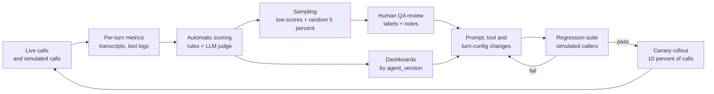

# Voice AI Agent Prototype: Evaluation and Observability

Companion to [ARCHITECTURE.md](ARCHITECTURE.md) and [DATAFLOW.md](DATAFLOW.md).

The goal is to be able to answer three questions about any call, any agent version, or any week of traffic:

1. **Was it fast?** Per-stage latency and voice-to-voice latency against the budget.
2. **Was it natural?** Interruptions, talk-over, silences, re-prompts.
3. **Did it work?** Task success, correct tool use, transfers, outcomes.

---

## 1. Evaluation loop



---

## 2. Metrics logged per call

### 2.1 Latency (per turn, rolled up per call as p50 / p95 / max)

| Metric | Definition | Source | Target (p50 / p95) |
|---|---|---|---|
| `transport_in_ms` | Twilio media timestamp → frame received by the Agent | Twilio `media.timestamp` vs. receive clock | 30 / 60 |
| `eot_ms` | Last VAD speech frame → end-of-turn decision | VAD + smart-turn | 200 / 300 |
| `stt_final_ms` | End-of-turn → final transcript received | Deepgram events | 60 / 150 |
| `llm_ttft_ms` | LLM request sent → first text token | LLM stream | 280 / 500 |
| `llm_total_ms` | LLM request sent → stream finished | LLM stream | informational |
| `agg_ms` | First token → first chunk sent to TTS | Sentence aggregator | 30 / 80 |
| `tts_ttfb_ms` | TTS request → first audio byte | TTS stream | 90 / 180 |
| `transport_out_ms` | First audio byte → first `media` frame sent (plus the `mark` ack round trip) | Transport | 50 / 90 |
| **`v2v_ms`** | **Caller stops speaking → first agent audio sent to Twilio, plus a measured one-way estimate** | Derived | **≤ 800 / ≤ 1,500** |
| `tool_latency_ms` | Per tool invocation | Tool executor | 400 / 1,500 |
| `bargein_stop_ms` | Caller speech start → `clear` sent | Interruption controller | ≤ 250 |
| `greeting_ms` | Media stream `start` → first greeting frame | Transport | ≤ 1,200 (from answer) |
| `pstn_rtt_ms` (sampled) | Carrier leg, measured with test calls | Synthetic monitor | informational, outside budget |

### 2.2 Conversation quality

| Metric | Definition |
|---|---|
| `interruption_count` | Barge-ins by the caller that cancelled agent speech |
| `false_interruption_count` | Barge-ins where the caller's utterance was a backchannel or noise (STT shows 0–1 words and the caller did not take the turn) |
| `agent_talkover_count` | Agent started speaking while the caller was still speaking (turn taken too early: a smart-turn miss) |
| `long_silence_count` | Gaps of more than 3 s with nobody speaking |
| `reprompt_count` | "Are you still there?" prompts |
| `avg_agent_turn_words` | Verbosity check (target: about 25 words per turn or fewer) |
| `talk_ratio` | Agent talk time / total talk time |
| `asr_confidence_avg`, `low_confidence_turns` | Mean STT confidence; turns below 0.6 |
| `language_switches` | Detected language changes mid-call |
| `failover_events` | STT / LLM / TTS provider switches during the call |

### 2.3 Task and business outcome

| Metric | Definition |
|---|---|
| `task_success` (bool) | Playbook-specific: booking created / lead qualified with all required fields / issue resolved without transfer / follow-up confirmed. Computed by rules from tool calls and outcome, cross-checked by the LLM judge |
| `disposition` | See DATAFLOW.md §3 |
| `transfer_requested`, `transfer_connected` | Transfer rate = transferred calls / answered calls; connect rate = connected / requested |
| `transfer_reason` | `caller_request`, `out_of_scope`, `frustration`, `agent_failure`, `policy` |
| `containment` | Call finished without a human |
| `amd_result`, `amd_correct` | AMD outcome; correctness labelled from recordings in human QA |
| `call_duration_s`, `time_to_task_s` | Total length; time until the success event (for example, booking confirmed) |
| `opt_out` | Caller asked not to be called again |
| `cost_usd` | Telephony + STT minutes + LLM tokens + TTS characters |

### 2.4 Tool calls

| Metric | Definition |
|---|---|
| `tool_calls_total` per tool | Count |
| `tool_success_rate` | `success / total` per tool |
| `tool_error_rate`, `tool_timeout_rate` | By error code |
| `tool_arg_invalid_rate` | Schema-validation rejections (a prompt or schema problem) |
| `tool_duplicate_blocked` | Idempotency hits (would have double-written) |
| `unconfirmed_write_attempts` | Write tool called without `confirmed=true` (should be 0) |
| `hallucinated_action_rate` | LLM judge: the agent *said* it did something with no matching successful tool call (critical, should be 0) |

### 2.5 LLM-judge rubric (post-call, per call)

Run in the Worker on the redacted transcript and tool log, using a fixed `rubric_version`. Scores are 1–5:

| Dimension | Question |
|---|---|
| Goal completion | Did the agent achieve the playbook goal, or correctly decide it could not be achieved? |
| Accuracy | Were all facts and tool results reported correctly? No invented availability, prices or policies? |
| Instruction following | Disclosures given? Confirmation read-back before writes? Stayed in scope? |
| Conversational quality | Concise, natural, no repetition, handled interruptions gracefully? |
| Escalation judgment | Transferred when it should have, and not when it shouldn't have? |
| Tone and empathy | Appropriate for a frustrated or confused caller? |

The LLM judge is calibrated against human labels: a 100-call labelled set, tracking agreement (Cohen's kappa per dimension). If agreement drops below 0.6 the rubric is revised.

---

## 3. Pre-release evaluation: simulated callers

* **Scenario library** (`evals/scenarios/`): each scenario has a persona (for example, "elderly caller, speaks slowly, mishears times"), a goal, hidden facts, the expected disposition, and must-pass checks (for example, "books Tuesday at 4 pm", "never books without confirmation").
* **Harness** (`tests/simulation/`): an LLM-driven caller with its own TTS voice and STT dials the agent through a Twilio test number or a loopback WebSocket transport. Audio effects (8 kHz codec, background noise, packet loss, accents) are injected to stress STT and turn-taking.
* **Gates**: an agent version cannot be rolled out if task success drops more than 3 points, any critical check fails (hallucinated action, missing disclosure), or p95 `v2v_ms` regresses by more than 10%.
* **Coverage targets for v1**: 40 scenarios across 4 playbooks × {happy path, interruption-heavy, off-topic, tool failure, transfer request, language switch, voicemail}.

---

## 4. Logging and observability plan

### 4.1 Signals

| Signal | Tool | What |
|---|---|---|
| **Traces** | OpenTelemetry → X-Ray (infra) and Langfuse (LLM) | One trace per call: `call` → `turn[n]` → spans `stt`, `eot`, `llm`, `tool:{name}`, `tts`, `transport`. Trace id derived from `CallSid` and propagated to webhooks, SQS messages and the Worker |
| **Metrics** | OTel metrics → CloudWatch (EMF) | Histograms for every latency metric in §2.1 with dimensions `agent_version`, `playbook`, `direction`, `language`, `provider`. Counters: calls, interruptions, transfers, tool errors, failovers. Gauge: `active_calls` per task (also the autoscaling signal) |
| **Logs** | Structured JSON (structlog) → CloudWatch Logs | Per-event logs with `call_id`, `trace_id`, `turn_seq`. PII deny-list filter. No raw transcript text |
| **Call records** | Postgres | Source of truth for analytics (Turn, ToolInvocation, Outcome, EvalResult) |
| **Recordings + transcripts** | S3 | Audio and transcript artifacts for QA and re-scoring |

### 4.2 Dashboards (CloudWatch or Grafana)

1. **Real-time ops**: active calls, call arrival rate, error rate, provider health, p50 and p95 `v2v_ms` over the last 15 min.
2. **Latency waterfall**: stacked per-stage p50 and p95 per `agent_version`, to find which stage moved.
3. **Quality**: task success, containment, transfer rate, interruption rate, judge scores by playbook and version.
4. **Tools**: success, error and timeout rates and latency per tool and integration.
5. **Business** (nice to have, call analytics): calls per day, bookings, qualified leads, cost per successful outcome, peak hours, top transfer reasons, top unanswered intents.

### 4.3 Alerts

| Alert | Condition |
|---|---|
| Latency regression | p95 `v2v_ms` > 1,500 ms for 5 min |
| LLM slow | p95 `llm_ttft_ms` > 800 ms for 5 min, which triggers a failover review |
| Provider failures | STT/TTS/LLM error rate > 2% for 5 min |
| Tool outage | Any tool error rate > 10% for 5 min |
| Call drops | Media streams closing without `call.ended` > 1% |
| Critical eval | Any `hallucinated_action` or `missing_disclosure` flag |
| Capacity | `active_calls` > 80% of fleet capacity |

### 4.4 Transcript storage approach

* **During the call**: final transcript segments (both channels, with word timestamps) are held in memory and written asynchronously to Postgres per turn. Writes are batched and never block the audio path.
* **After the call**: the Worker assembles a canonical transcript JSON per call:

  ```json
  {
    "call_id": "uuid",
    "agent_version": "uuid",
    "language": "en-US",
    "segments": [
      {"seq": 1, "channel": "agent", "start_ms": 0, "end_ms": 4200, "text": "...", "interrupted": false},
      {"seq": 2, "channel": "caller", "start_ms": 4900, "end_ms": 6100, "text": "...", "confidence": 0.93}
    ],
    "tools": [{"turn_seq": 5, "name": "book_slot", "status": "success", "latency_ms": 640}],
    "outcome": {"disposition": "booked", "task_success": true}
  }
  ```

  It is stored as `s3://<bucket>/transcripts/raw/{yyyy}/{mm}/{dd}/{call_id}.json` and as a redacted copy under `transcripts/redacted/`.
* **Optional re-transcription**: for QA accuracy, the dual-channel recording can be re-transcribed in batch (Deepgram pre-recorded, higher accuracy). The result is stored as `transcript_v2` and compared with the live transcript to measure live STT word error rate.
* **Searchability**: redacted text in Postgres with full-text search (`tsvector`). Embeddings (pgvector) are a later addition, for "find calls where people asked about X".

---

## 5. Targets for the prototype exit review

| KPI | Target |
|---|---|
| p50 voice-to-voice | ≤ 800 ms |
| p95 voice-to-voice | ≤ 1,500 ms |
| Task success (booking playbook) | ≥ 70% of eligible calls |
| Tool success rate | ≥ 98% |
| Hallucinated actions | 0 |
| False interruption rate | ≤ 5% of agent turns |
| Unwanted transfer rate (`agent_failure` reason) | ≤ 5% of calls |
| AMD accuracy | ≥ 90% on the labelled sample |
| LLM-judge / human agreement | kappa ≥ 0.6 |
